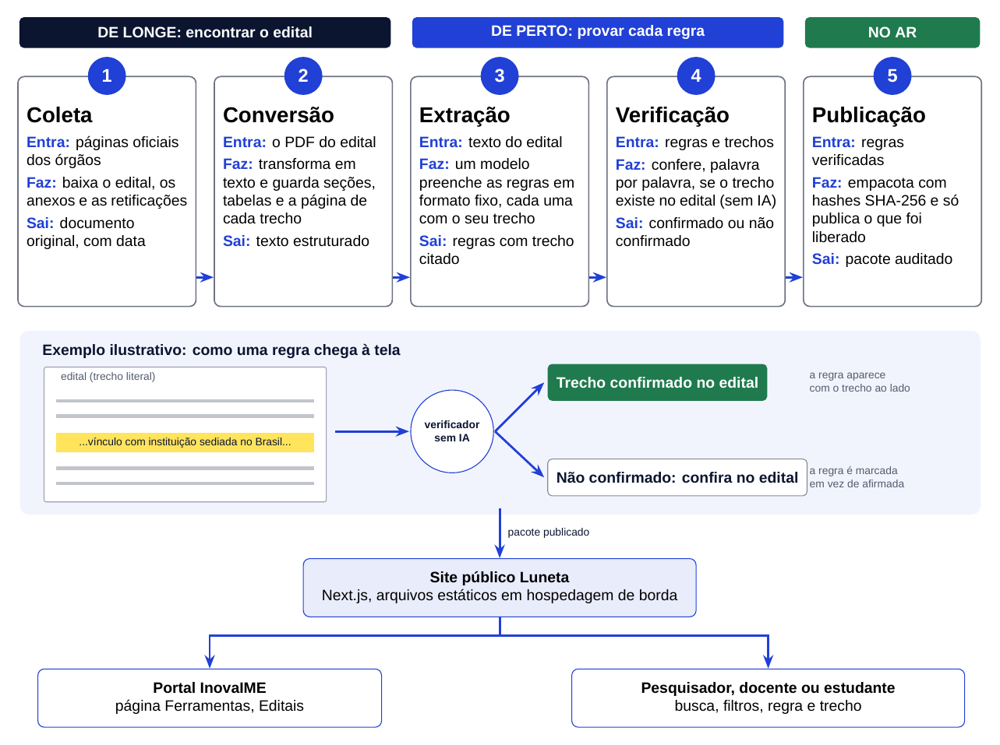

# Luneta · Documentação pública

**De longe, o edital. De perto, a prova.**

A Luneta é uma plataforma web que lê editais de fomento à pesquisa, extrai as regras de cada edital e mostra, ao lado de cada regra, o **trecho literal do documento oficial que a comprova**. Quando não encontra o trecho, marca a informação como **não confirmada**.

- Site: <https://lunetaoportunidades.com.br>
- Integrada à página *Ferramentas, Editais* do Portal InovaIME: <https://inova.ime.eb.br/ferramentas/editais>

> **Este repositório contém só documentação.** O código-fonte da Luneta está em repositório privado da organização. Para avaliação ou continuidade acadêmica, o acesso de leitura é concedido mediante solicitação à equipe.

## O que a Luneta faz

1. **De longe:** acompanha as páginas oficiais dos órgãos de fomento, reúne os editais e permite buscar e filtrar por situação, órgão e público.
2. **De perto:** lê cada edital regra por regra e mostra o trecho do documento ao lado de cada regra. Um verificador, sem inteligência artificial, confere se o trecho citado existe palavra por palavra no edital.

A Luneta é uma triagem. Ela não substitui a leitura do edital oficial.

## Estado em 13/11/2026

Números lidos no site em produção nessa data:

| Item | Valor |
|---|---|
| Editais no catálogo | 179 |
| Órgãos de fomento | 10 (CAPES, CNPq, EMBRAPII, FAPEMIG, FAPERJ, FAPES, FAPESC, FAPESP, FAPPR e FINEP) |
| Integração | Página de editais do Portal InovaIME |

## Documentação

| Documento | Conteúdo |
|---|---|
| [docs/arquitetura.md](docs/arquitetura.md) | Pipeline, componentes e tecnologias |
| [docs/manual-do-usuario.md](docs/manual-do-usuario.md) | Como usar o site, passo a passo |
| [docs/estrutura-do-repositorio.md](docs/estrutura-do-repositorio.md) | Organização do repositório privado de código |
| [docs/eap-e-responsabilidades.md](docs/eap-e-responsabilidades.md) | EAP final e responsabilidades da equipe |
| [docs/telas.md](docs/telas.md) | Capturas de tela do produto |

## Contexto

Projeto da disciplina Introdução a Projeto de Engenharia II (IPE II), 2026.2, do Instituto Militar de Engenharia (IME). Cliente institucional: AGITEC. Orientador: Maj Girardi.

**Equipe:** Miguel Sadoc Hackbart do Nascimento, Raimundo Nonato Holanda Costa Filho, Nícolas Boghi Negre, Eli Jacobovicz e Pedro Eiji Gonçalves Nojima.

## Direitos

© 2026 Equipe Luneta. Todos os direitos reservados. A documentação pode ser lida e citada com indicação da fonte. O código-fonte e a marca não são cedidos.
