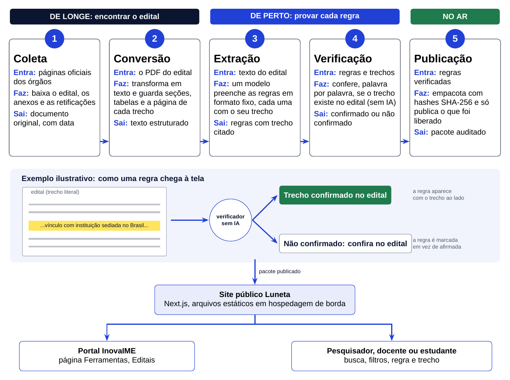

# Arquitetura

O caminho de cada regra, do edital até a tela, tem cinco etapas e uma entrega.

| Etapa | O que faz | Tecnologia |
|---|---|---|
| 1. Coleta | Coletores por órgão baixam o edital, os anexos e as retificações, e guardam o documento original com data. | Python 3.12, navegador automatizado quando o site do órgão exige (FINEP), manifesto de fontes |
| 2. Conversão | Transforma o PDF em texto estruturado, preservando seções, tabelas e a página de cada trecho. | Docling, OCR quando necessário |
| 3. Extração | Um modelo de linguagem lê o edital e preenche um formato fixo. Cada regra aponta o trecho de onde saiu. | Modelos por API, saída restrita a esquema JSON fixo (`jsonschema`), módulos por tema |
| 4. Verificação | Confere, sem IA, se cada trecho existe literalmente no texto do edital. Detecta trechos riscados em retificações. | Validador determinístico em Python |
| 5. Publicação | Empacota os dados com hashes SHA-256 e só importa o que foi liberado. Varredura de privacidade e auditoria da saída rodam no build. | Pacote de dados, importador, auditoria |
| Entrega | Site estático, incorporado ao Portal InovaIME. | Next.js 16, React 19, TypeScript 5.9, Cloudflare Pages |

## Módulos de extração

| Módulo | O que extrai | Selo no site |
|---|---|---|
| Quem pode participar | Papéis, requisitos e exclusões, com a quem cada regra se aplica | Extração oficial |
| Visão geral | Objetivo, temas e abrangência geográfica | Em validação |
| Quando agir | Datas fixas e prazos relativos, sem inventar datas | Em validação |
| O que oferece | Valor acessível ao candidato, duração, contrapartida e usos permitidos | Experimental |

## Princípios

- **Prova antes de opinião.** Toda informação aponta para o trecho de onde veio.
- **Não confirmado é uma resposta válida.** A Luneta marca o que não conseguiu confirmar em vez de afirmar.
- **Só números medidos.** Contagens vêm do sistema, com data.
- **Nenhuma página é preenchida à mão.** O conteúdo vem do importador, que confere hashes e versões.
