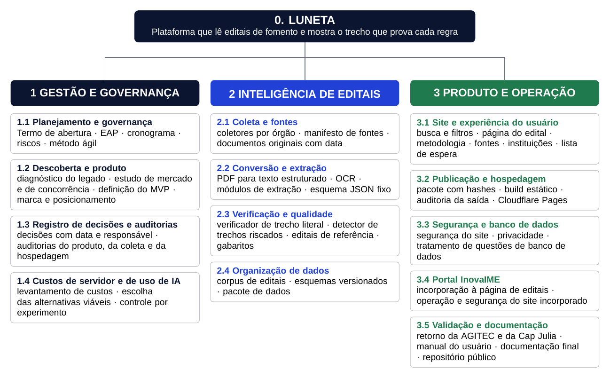

# EAP final e responsabilidades

## Responsabilidades

R: executa. A: responde pelo resultado. C: consultado. I: informado.

| Componente | Sadoc | Nonato | Negreli | Eli | Nojima |
|---|:-:|:-:|:-:|:-:|:-:|
| 1.1 Planejamento e governança | C | A/R | C | C | C |
| 1.2 Descoberta e produto | C | A/R | C | I | I |
| 1.3 Registro de decisões e auditorias | C | A/R | I | I | I |
| 1.4 Custos de servidor e de uso de IA | C | A | I | I | R |
| 2.1 Coleta e fontes | C | I | A/R | I | C |
| 2.2 Conversão e extração | A/R | C | C | I | I |
| 2.3 Verificação e qualidade | A/R | C | R | I | I |
| 2.4 Organização de dados | C | I | A/R | C | R |
| 3.1 Site e experiência do usuário | R | A/R | I | C | I |
| 3.2 Publicação e hospedagem | A/R | C | I | C | C |
| 3.3 Segurança e banco de dados | C | I | I | A/R | I |
| 3.4 Portal InovaIME | I | A | I | R | I |
| 3.5 Validação e documentação | C | A/R | C | C | C |

## Frentes

- **Sadoc:** liderança técnica. Conversão, extração, verificação e publicação do site.
- **Nonato:** gerência do projeto, descoberta e produto, marca, texto do site e relação com o orientador e a AGITEC.
- **Negreli:** coletores e fundação de dados.
- **Eli:** segurança cibernética do site, banco de dados, operações e integração.
- **Nojima:** análise de custos (servidor e uso de IA) e organização de dados.
