# Telas do produto

Capturas do site em produção, feitas em 13/11/2026.

**Página inicial**

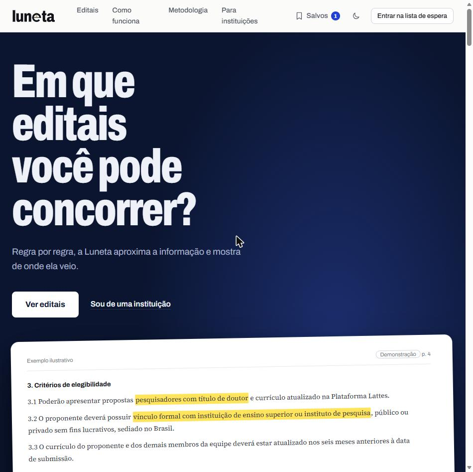

**Busca e lista de editais**

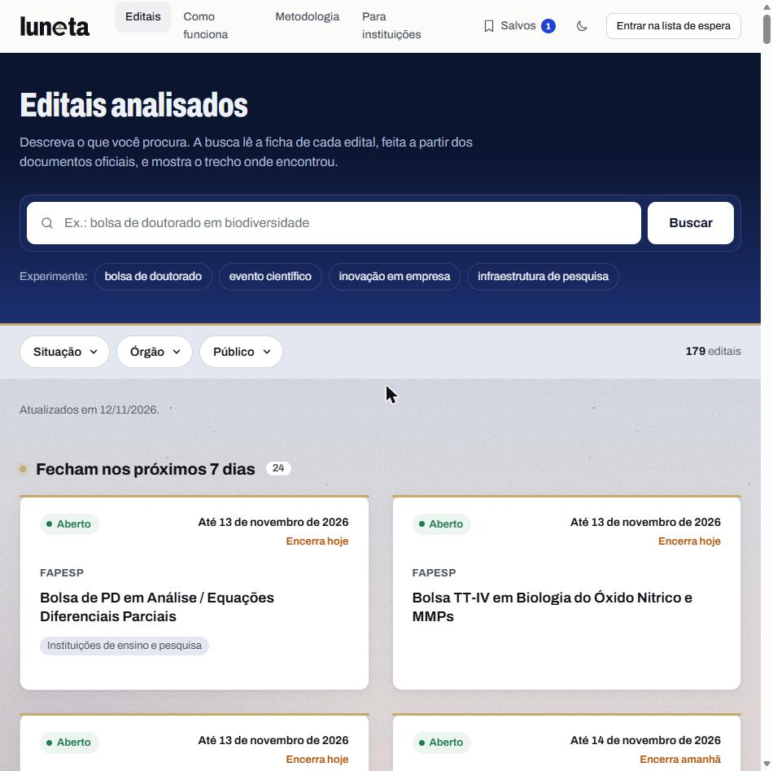

**Página de um edital**

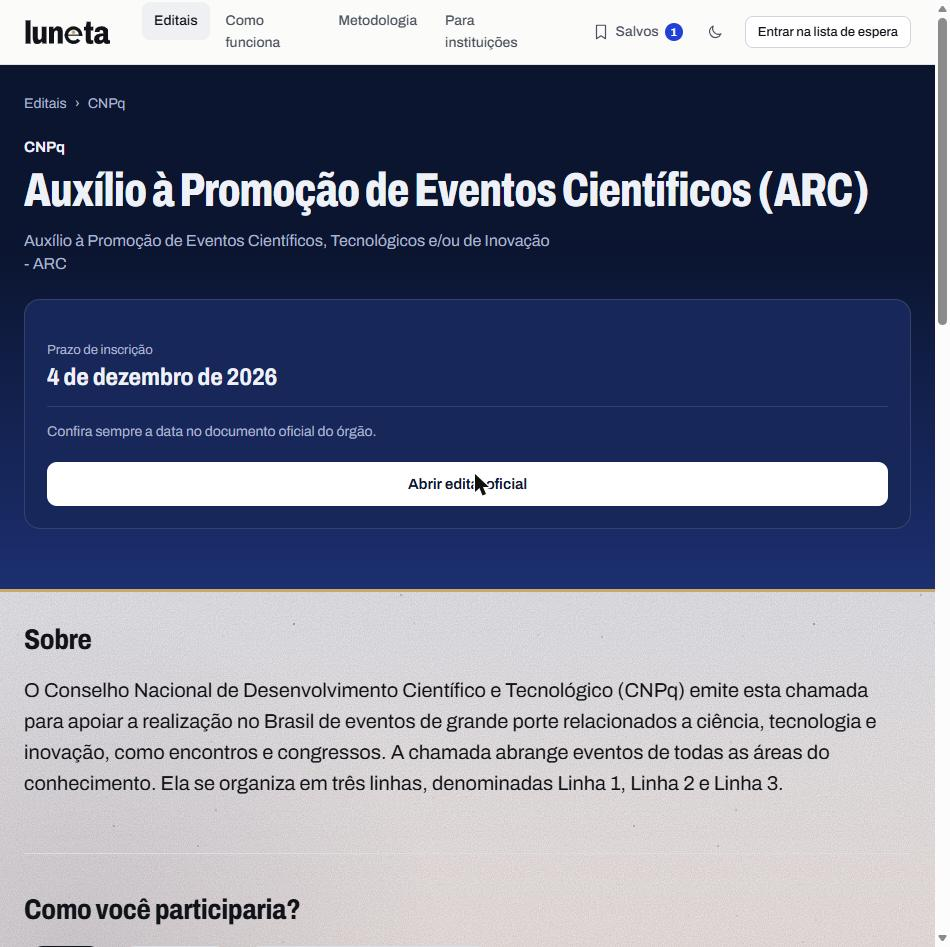

**Como você participaria? O edital organizado por papel**

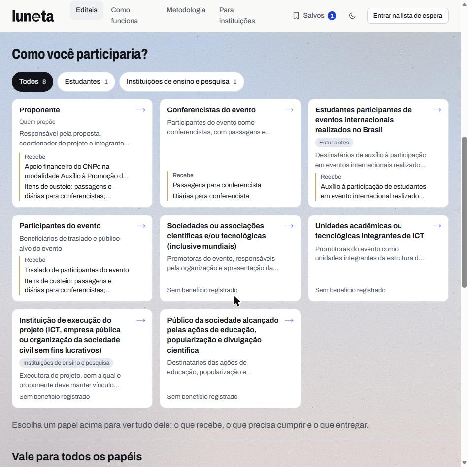

**O que o papel recebe, com os itens do edital que comprovam cada informação**

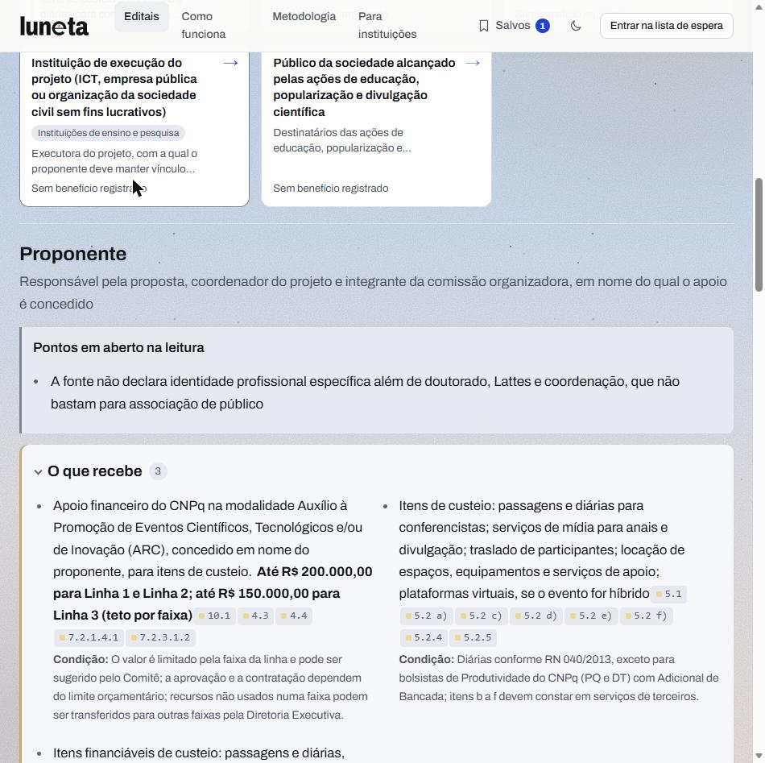

**Quem pode participar, com a referência ao item do edital**

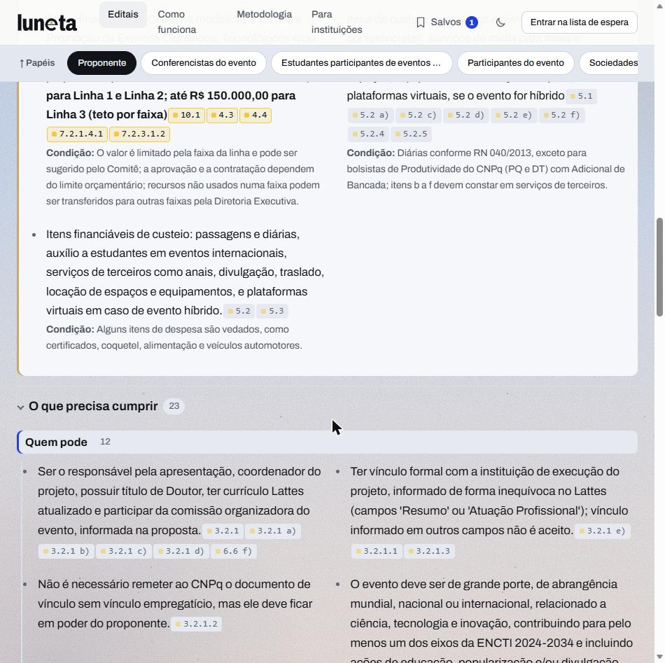

**Metodologia**

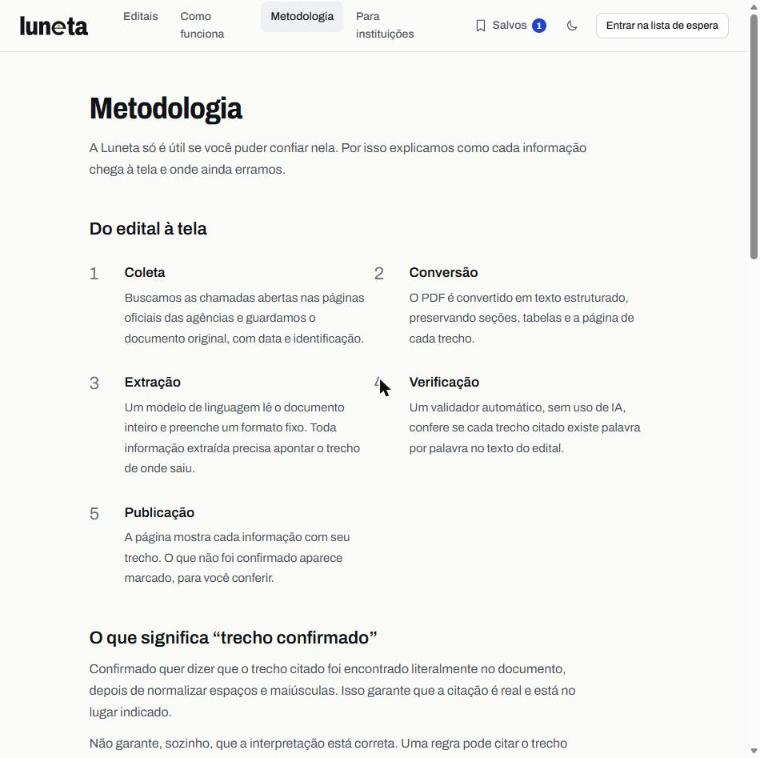

**Fontes**

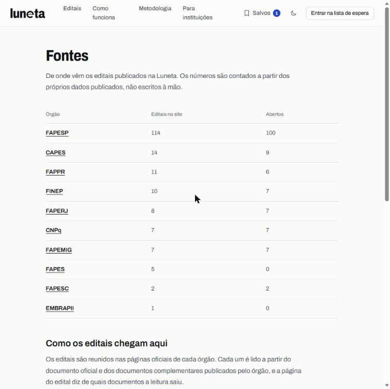

**Para instituições**

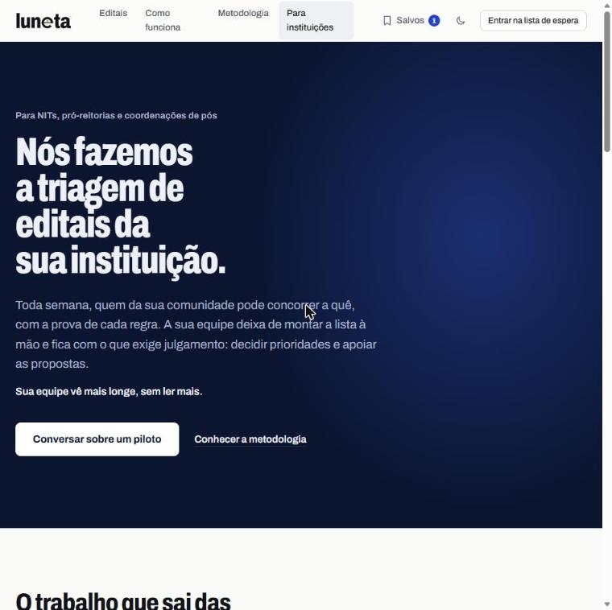

**Lista de espera**

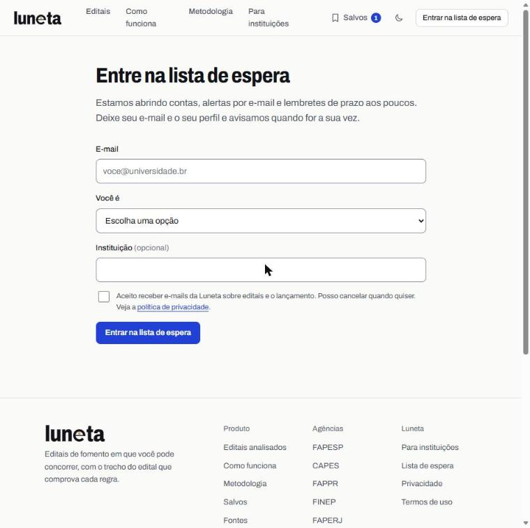

**Integração com o Portal InovaIME**

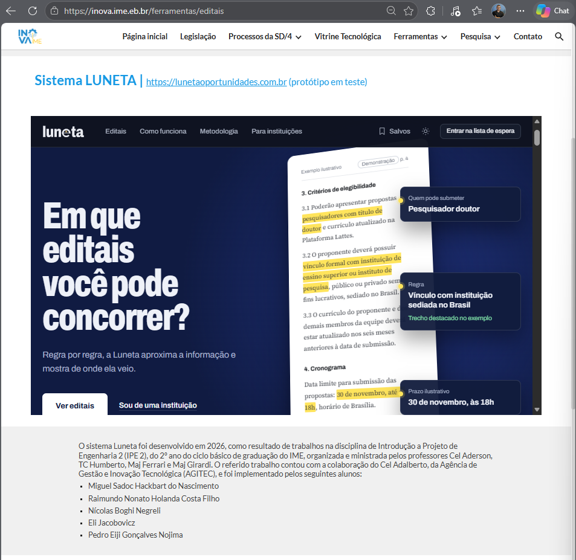
